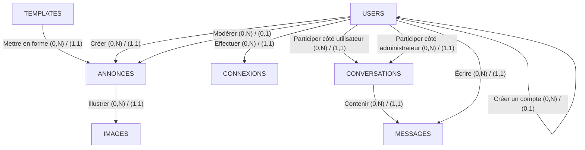
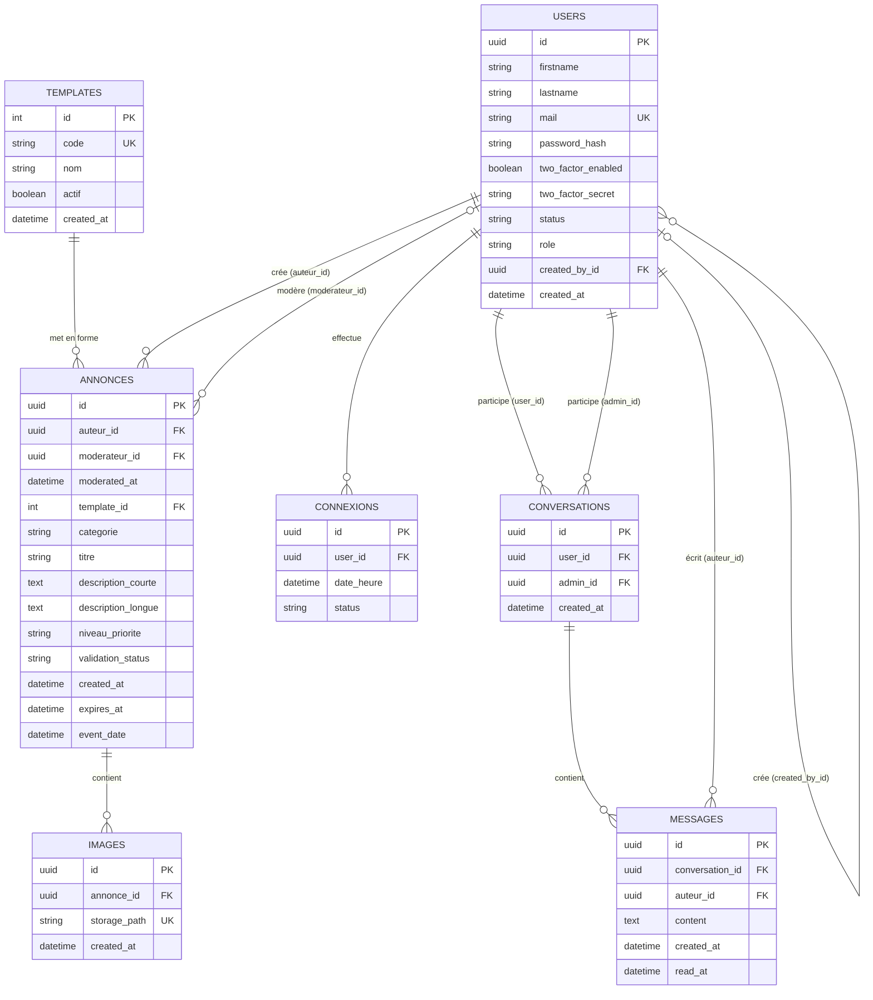

# Base de données – schéma v2

Nov 6, 2026 · @Le T

## 1. Cardinalités définitives

Les anciennes tables USERS, ADMINS et SUPERADMINS forment une seule table USERS portant un rôle (USER, ADMIN ou SUPERADMIN). Une table IMAGES s'ajoute pour les photos des annonces, et une table TEMPLATES liste les modèles d'affichage qu'une annonce peut utiliser.

| Relation | Cardinalités | Explication |
| --- | --- | --- |
| USERS — Créer — ANNONCES | `USERS (0,N) — (1,1) ANNONCES` | Un utilisateur, quel que soit son rôle, peut créer plusieurs annonces. Chaque annonce possède un seul auteur. |
| USERS — Modérer — ANNONCES | `USERS (0,N) — (0,1) ANNONCES` | Un utilisateur ADMIN ou SUPERADMIN peut modérer plusieurs annonces. Une annonce est en attente (aucun modérateur) ou traitée par un seul modérateur, qui n'est jamais son auteur. |
| ANNONCES — Illustrer — IMAGES | `ANNONCES (0,N) — (1,1) IMAGES` | Une annonce peut avoir plusieurs images, ou aucune. Chaque image appartient à une seule annonce. |
| USERS — Effectuer — CONNEXIONS | `USERS (0,N) — (1,1) CONNEXIONS` | Un utilisateur peut avoir plusieurs connexions. |
| USERS — Participer (côté utilisateur) — CONVERSATIONS | `USERS (0,N) — (1,1) CONVERSATIONS` | Un utilisateur peut participer à plusieurs conversations. |
| USERS — Participer (côté administrateur) — CONVERSATIONS | `USERS (0,N) — (1,1) CONVERSATIONS` | Un utilisateur ADMIN ou SUPERADMIN peut participer à plusieurs conversations. |
| CONVERSATIONS — Contenir — MESSAGES | `CONVERSATIONS (0,N) — (1,1) MESSAGES` | Une conversation peut contenir plusieurs messages. Chaque message appartient à une seule conversation. |
| USERS — Écrire — MESSAGES | `USERS (0,N) — (1,1) MESSAGES` | Un utilisateur peut écrire plusieurs messages. Chaque message a exactement un auteur. |
| USERS — Créer un compte — USERS | `USERS (0,N) — (0,1) USERS` | Un ADMIN ou un SUPERADMIN peut créer plusieurs comptes. Un compte a au plus un créateur : aucun pour une inscription libre ni pour le premier superadmin. |
| TEMPLATES — Mettre en forme — ANNONCES | TEMPLATES (0,N) — (1,1) ANNONCES | Un template peut servir à plusieurs annonces, ou à aucune. Chaque annonce utilise exactement un template : le template 0 (STANDARD) si aucun autre n'est choisi. Le template lui-même est du code front-end, la base ne garde qu'une référence. |

## 2. Diagramme EA avec Mermaid

Ce diagramme représente les entités et les relations métier. Un administrateur est un utilisateur : il n'y a plus d'entités ADMINS ni SUPERADMINS, le rôle est un attribut de USERS. Un administrateur peut créer des annonces, mais ne peut pas modérer les siennes.



### Fonctionnement de la modération

1. Un utilisateur, quel que soit son rôle, crée une annonce.
2. L'annonce est enregistrée avec le statut `EN_ATTENTE` et sans modérateur.
3. Un utilisateur ADMIN ou SUPERADMIN, autre que l'auteur, examine l'annonce.
4. Il la valide ou la refuse.
5. Le statut passe à `VALIDE` ou `DECLINE`, et `moderateur_id` contient le modérateur.

Un administrateur ne peut donc jamais valider sa propre annonce (conflit d'intérêts). La base de données garantit quatre règles : `moderateur_id` est `NULL` si et seulement si le statut est `EN_ATTENTE`, `moderateur_id` est toujours différent de `auteur_id`, `moderated_at` est rempli en même temps que `moderateur_id` (jamais l'un sans l'autre), et `moderated_at` n'est pas antérieur à `created_at`. Il n'y a pas de motif de refus en base : les échanges avec l'auteur passent par les conversations. Que le modérateur ait bien le rôle ADMIN ou SUPERADMIN est vérifié par le back-end.

## 3. Diagramme relationnel avec Mermaid

Voici le modèle relationnel correspondant à ces règles : six tables au lieu de huit.



## Contraintes importantes pour PostgreSQL

**1. Une annonce et un message ont toujours un auteur.**

Les champs `annonces.auteur_id` et `messages.auteur_id` sont `NOT NULL` et référencent `users`. L'ancienne contrainte « exactement un auteur » n'existe plus : avec une seule colonne, l'état impossible n'est plus représentable.

**2. Un modérateur n'est jamais l'auteur, et son statut est cohérent.**

Deux `CHECK` sur `annonces` : `moderateur_id` est différent de `auteur_id`, et `moderateur_id` est `NULL` si et seulement si `validation_status` vaut `EN_ATTENTE`.

**3. Un rôle parmi trois, un mail unique sans distinction de casse.**

`role` vaut `USER`, `ADMIN` ou `SUPERADMIN` (`CHECK`). L'unicité du mail porte sur `lower(mail)`, sinon `A@x.com` et `a@x.com` seraient deux comptes.

**4. Les images sont des références, les fichiers sont dans Supabase Storage.**

`images.storage_path` contient le chemin du fichier dans le bucket et est unique. Le stockage n'a pas de clés étrangères : le back-end supprime les fichiers avant l'annonce, ce que force `ON DELETE RESTRICT`.

**5. Règles que la base ne peut pas vérifier, donc à garantir dans le back-end.**

Le modérateur d'une annonce et l'`admin_id` d'une conversation doivent avoir le rôle ADMIN ou SUPERADMIN, car un `CHECK` ne compare pas deux lignes différentes.

**6. Row Level Security activée sur toutes les tables.**

Supabase expose les tables du schéma `public` via sa propre API. Sans politique, cette API publique ne voit rien : seul le back-end accède aux données.

**7. Chaque annonce a un template qui existe.**

`annonces.template_id` est `NOT NULL`, vaut `0` par défaut et référence `templates` : la base refuse un template inexistant. Le template `0` (`STANDARD`) est inséré à la création de la base et ne peut jamais être désactivé. Un template est du code front-end : la base ne garde que son `code`, que le front associe à un composant. On désactive un template (`actif`) au lieu de le supprimer, et `ON DELETE RESTRICT` empêche de supprimer un template encore utilisé. Le back-end doit envoyer `0` explicitement quand aucun template n'est choisi : un `NULL` envoyé par JPA est refusé, il ne déclenche pas la valeur par défaut.

**8. La date d'événement est facultative.**

`annonces.event_date` ne concerne que les annonces qui ont une date précise (un événement par exemple). Aucune règle n'oblige la catégorie à correspondre.

**9. Le mot de passe n'est jamais stocké en clair.**

`users.password_hash` est `NOT NULL` et ne contient que le hash calculé par Spring Security (bcrypt ou Argon2). Il n'est jamais renvoyé par l'API ni écrit dans les logs. Le premier superadmin est donc créé via le back-end, qui génère le hash.

**10. Pas de date de dernière modification.**

La colonne `updated_at` a été retirée : une seule date « modifié le » sans historique n'apprend pas grand-chose. Si l'historique des modifications devient un besoin, il aura sa propre table.

## Code PostgreSQL

À exécuter dans le SQL Editor de Supabase. À lancer sur une base vide : l'ordre compte, une table doit exister avant d'être référencée par une clé étrangère. Pour une base qui a déjà la version précédente, on lance le script de migration à la place.

```sql
-- =============================================================================
-- Database schema (PostgreSQL on Supabase)
-- Run in the Supabase SQL Editor ON AN EMPTY DATABASE. Order matters: a table
-- must exist before another table can reference it with a foreign key.
-- For a database that already has a previous version, run the migration-NNN
-- scripts in order instead (running this file would fail with
-- "already exists").
-- =============================================================================

-- -----------------------------------------------------------------------------
-- 1. USERS
-- Every person of the app lives here. Admins and superadmins are users with a
-- higher role: one person = one row = one login. The role is a single column
-- (not two booleans) so that an impossible state such as "superadmin but not
-- admin" cannot be represented at all.
-- No pgcrypto extension needed: gen_random_uuid() is built into PostgreSQL 13+.
-- -----------------------------------------------------------------------------
CREATE TABLE users (
    id                 UUID PRIMARY KEY DEFAULT gen_random_uuid(),

    firstname          VARCHAR(100) NOT NULL,
    lastname           VARCHAR(100) NOT NULL,
    mail               VARCHAR(255) NOT NULL,

    -- Hash (bcrypt/Argon2 computed by Spring Security), never the password
    -- itself. Must never be returned by the API nor written to logs.
    password_hash      VARCHAR(255) NOT NULL,

    two_factor_enabled BOOLEAN      NOT NULL DEFAULT FALSE,
    two_factor_secret  TEXT,

    status             VARCHAR(20)  NOT NULL DEFAULT 'ACTIF',
    role               VARCHAR(20)  NOT NULL DEFAULT 'USER',

    -- Self-reference: who created this account. NULL for regular sign-ups
    -- and for the very first superadmin, who has no creator.
    created_by_id      UUID,

    created_at         TIMESTAMPTZ  NOT NULL DEFAULT CURRENT_TIMESTAMP,

    CONSTRAINT fk_users_created_by
        FOREIGN KEY (created_by_id)
        REFERENCES users(id)
        ON DELETE RESTRICT,

    CONSTRAINT chk_users_status
        CHECK (status IN ('ACTIF', 'BLOQUE')),

    CONSTRAINT chk_users_role
        CHECK (role IN ('USER', 'ADMIN', 'SUPERADMIN')),

    CONSTRAINT chk_users_not_self_created
        CHECK (created_by_id IS NULL OR created_by_id <> id)
);

-- A plain UNIQUE on "mail" is case-sensitive: "A@x.com" and "a@x.com" would be
-- two accounts. Indexing lower(mail) makes the uniqueness case-insensitive.
CREATE UNIQUE INDEX uq_users_mail_lower
    ON users (lower(mail));

-- -----------------------------------------------------------------------------
-- 2. TEMPLATES
-- Reference table: the list of display templates an announcement can use. A
-- template itself is front-end code (a React component); the database only
-- stores a stable "code" that the front maps to that component. Adding a
-- template = inserting a row, no schema change.
-- Integer identity (not UUID): small stable ids suit reference data, and the
-- standard template must have a fixed, well-known id (0).
-- -----------------------------------------------------------------------------
CREATE TABLE templates (
    id         INTEGER GENERATED BY DEFAULT AS IDENTITY PRIMARY KEY,

    code       VARCHAR(50)  NOT NULL,
    nom        VARCHAR(100) NOT NULL,

    -- Deactivate instead of delete: old announcements keep displaying, the
    -- template just stops being offered for new ones.
    actif      BOOLEAN      NOT NULL DEFAULT TRUE,

    created_at TIMESTAMPTZ  NOT NULL DEFAULT CURRENT_TIMESTAMP,

    CONSTRAINT uq_templates_code
        UNIQUE (code),

    -- The fallback template must always stay available.
    CONSTRAINT chk_templates_standard_actif
        CHECK (id <> 0 OR actif)
);

-- Explicit id 0 is allowed with GENERATED BY DEFAULT; later templates get 1, 2...
INSERT INTO templates (id, code, nom)
VALUES (0, 'STANDARD', 'Template standard');

-- -----------------------------------------------------------------------------
-- 3. ANNONCES
-- -----------------------------------------------------------------------------
CREATE TABLE annonces (
    id                 UUID PRIMARY KEY DEFAULT gen_random_uuid(),

    auteur_id          UUID         NOT NULL,
    -- NULL as long as nobody has processed the announcement.
    moderateur_id      UUID,
    -- When the moderator processed it. Filled together with moderateur_id.
    moderated_at       TIMESTAMPTZ,

    -- Display template. DEFAULT 0 applies only when the column is omitted from
    -- the INSERT: an explicit NULL (what JPA sends for an unset field) is
    -- rejected by NOT NULL, so the back-end must set 0 itself.
    template_id        INTEGER      NOT NULL DEFAULT 0,

    categorie          VARCHAR(50)  NOT NULL,
    titre              VARCHAR(255) NOT NULL,
    description_courte TEXT,
    description_longue TEXT         NOT NULL,

    niveau_priorite    VARCHAR(20)  NOT NULL DEFAULT 'STANDARD',
    validation_status  VARCHAR(20)  NOT NULL DEFAULT 'EN_ATTENTE',

    created_at         TIMESTAMPTZ  NOT NULL DEFAULT CURRENT_TIMESTAMP,
    expires_at         TIMESTAMPTZ,
    -- Optional: the date of the event itself, for announcements that have one.
    event_date         TIMESTAMPTZ,

    CONSTRAINT fk_annonces_auteur
        FOREIGN KEY (auteur_id)
        REFERENCES users(id)
        ON DELETE RESTRICT,

    CONSTRAINT fk_annonces_moderateur
        FOREIGN KEY (moderateur_id)
        REFERENCES users(id)
        ON DELETE RESTRICT,

    CONSTRAINT fk_annonces_template
        FOREIGN KEY (template_id)
        REFERENCES templates(id)
        ON DELETE RESTRICT,

    CONSTRAINT chk_annonces_categorie
        CHECK (categorie IN (
            'OBJET_TROUVE',
            'OBJET_A_DONNER',
            'EVENEMENT',
            'APPEL_A_PROJET',
            'PUBLICITE',
            'ANNONCE_ADMINISTRATION'
        )),

    CONSTRAINT chk_annonces_priorite
        CHECK (niveau_priorite IN ('STANDARD', 'HAUTE_PRIORITE', 'A_LA_UNE')),

    CONSTRAINT chk_annonces_validation
        CHECK (validation_status IN ('EN_ATTENTE', 'VALIDE', 'DECLINE')),

    -- Conflict of interest: nobody moderates their own announcement.
    -- Last line of defence in case the application code has a bug.
    CONSTRAINT chk_annonces_no_self_moderation
        CHECK (moderateur_id IS NULL OR moderateur_id <> auteur_id),

    -- The status and the moderator must tell the same story:
    -- pending <=> no moderator yet; validated or declined <=> a moderator acted.
    CONSTRAINT chk_annonces_moderation_coherence
        CHECK (
            (validation_status = 'EN_ATTENTE' AND moderateur_id IS NULL)
            OR
            (validation_status <> 'EN_ATTENTE' AND moderateur_id IS NOT NULL)
        ),

    -- Who and when go together: both empty (pending) or both filled.
    CONSTRAINT chk_annonces_moderated_at_coherence
        CHECK ((moderateur_id IS NULL) = (moderated_at IS NULL)),

    CONSTRAINT chk_annonces_moderated_after_creation
        CHECK (moderated_at IS NULL OR moderated_at >= created_at),

    CONSTRAINT chk_annonces_dates
        CHECK (expires_at IS NULL OR expires_at > created_at)
);

-- -----------------------------------------------------------------------------
-- 4. IMAGES
-- Metadata only: the file itself lives in a Supabase Storage bucket (same
-- project, no second database). storage_path is the only link between the
-- two. Storage has no foreign keys, so consistency between a row and its file
-- is the back-end's responsibility.
-- ON DELETE RESTRICT on purpose: with CASCADE, deleting an announcement would
-- erase the paths and leave orphan files in the bucket. RESTRICT forces the
-- back-end to delete the files first.
-- -----------------------------------------------------------------------------
CREATE TABLE images (
    id            UUID PRIMARY KEY DEFAULT gen_random_uuid(),

    annonce_id    UUID         NOT NULL,
    storage_path  VARCHAR(500) NOT NULL,

    created_at    TIMESTAMPTZ  NOT NULL DEFAULT CURRENT_TIMESTAMP,

    CONSTRAINT fk_images_annonces
        FOREIGN KEY (annonce_id)
        REFERENCES annonces(id)
        ON DELETE RESTRICT,

    -- Two rows must never point to the same file.
    CONSTRAINT uq_images_storage_path
        UNIQUE (storage_path)
);

-- -----------------------------------------------------------------------------
-- 5. CONNEXIONS
-- -----------------------------------------------------------------------------
CREATE TABLE connexions (
    id         UUID PRIMARY KEY DEFAULT gen_random_uuid(),

    user_id    UUID        NOT NULL,
    date_heure TIMESTAMPTZ NOT NULL DEFAULT CURRENT_TIMESTAMP,
    status     VARCHAR(20) NOT NULL,

    CONSTRAINT fk_connexions_users
        FOREIGN KEY (user_id)
        REFERENCES users(id)
        ON DELETE RESTRICT,

    CONSTRAINT chk_connexions_status
        CHECK (status IN ('REUSSIE', 'ECHOUEE', 'DECONNECTE'))
);

-- -----------------------------------------------------------------------------
-- 6. CONVERSATIONS
-- A conversation links a user and an admin. Both columns reference users:
-- that the second one really has the ADMIN role cannot be expressed with a
-- CHECK (it compares two different rows), so the back-end enforces it.
-- -----------------------------------------------------------------------------
CREATE TABLE conversations (
    id         UUID PRIMARY KEY DEFAULT gen_random_uuid(),

    user_id    UUID        NOT NULL,
    admin_id   UUID        NOT NULL,

    created_at TIMESTAMPTZ NOT NULL DEFAULT CURRENT_TIMESTAMP,

    CONSTRAINT fk_conversations_user
        FOREIGN KEY (user_id)
        REFERENCES users(id)
        ON DELETE RESTRICT,

    CONSTRAINT fk_conversations_admin
        FOREIGN KEY (admin_id)
        REFERENCES users(id)
        ON DELETE RESTRICT,

    CONSTRAINT chk_conversations_distinct_participants
        CHECK (user_id <> admin_id)
);

-- -----------------------------------------------------------------------------
-- 7. MESSAGES
-- Since admins are users, a single author column is enough: the old
-- "exactly one author" constraint is no longer needed because the impossible
-- state does not exist anymore.
-- -----------------------------------------------------------------------------
CREATE TABLE messages (
    id              UUID PRIMARY KEY DEFAULT gen_random_uuid(),

    conversation_id UUID        NOT NULL,
    auteur_id       UUID        NOT NULL,

    content         TEXT        NOT NULL,

    created_at      TIMESTAMPTZ NOT NULL DEFAULT CURRENT_TIMESTAMP,
    read_at         TIMESTAMPTZ,

    CONSTRAINT fk_messages_conversations
        FOREIGN KEY (conversation_id)
        REFERENCES conversations(id)
        ON DELETE RESTRICT,

    CONSTRAINT fk_messages_auteur
        FOREIGN KEY (auteur_id)
        REFERENCES users(id)
        ON DELETE RESTRICT,

    CONSTRAINT chk_messages_dates
        CHECK (read_at IS NULL OR read_at >= created_at)
);

-- -----------------------------------------------------------------------------
-- 8. INDEXES
-- PostgreSQL indexes primary keys and UNIQUE constraints automatically, but
-- NOT foreign keys. Without these, every join or lookup on a foreign key
-- scans the whole table.
-- -----------------------------------------------------------------------------
CREATE INDEX idx_users_created_by
    ON users (created_by_id);

CREATE INDEX idx_annonces_auteur
    ON annonces (auteur_id);

CREATE INDEX idx_annonces_moderateur
    ON annonces (moderateur_id);

CREATE INDEX idx_annonces_template
    ON annonces (template_id);

CREATE INDEX idx_annonces_statut
    ON annonces (validation_status);

CREATE INDEX idx_annonces_date_creation
    ON annonces (created_at DESC);

CREATE INDEX idx_images_annonce
    ON images (annonce_id);

CREATE INDEX idx_connexions_user_date
    ON connexions (user_id, date_heure DESC);

CREATE INDEX idx_conversations_user
    ON conversations (user_id);

CREATE INDEX idx_conversations_admin
    ON conversations (admin_id);

CREATE INDEX idx_messages_conversation_date
    ON messages (conversation_id, created_at);

CREATE INDEX idx_messages_auteur
    ON messages (auteur_id);

-- -----------------------------------------------------------------------------
-- 9. ROW LEVEL SECURITY
-- Supabase automatically exposes tables of the "public" schema through its own
-- REST API. Our API is Spring Boot, so nobody should reach the tables that
-- way. With RLS enabled and no policy, that public API sees nothing.
-- Spring connects with the database owner role, which bypasses RLS
-- (to be verified when we connect Spring Boot).
-- -----------------------------------------------------------------------------
ALTER TABLE users         ENABLE ROW LEVEL SECURITY;
ALTER TABLE templates     ENABLE ROW LEVEL SECURITY;
ALTER TABLE annonces      ENABLE ROW LEVEL SECURITY;
ALTER TABLE images        ENABLE ROW LEVEL SECURITY;
ALTER TABLE connexions    ENABLE ROW LEVEL SECURITY;
ALTER TABLE conversations ENABLE ROW LEVEL SECURITY;
ALTER TABLE messages      ENABLE ROW LEVEL SECURITY;
```
