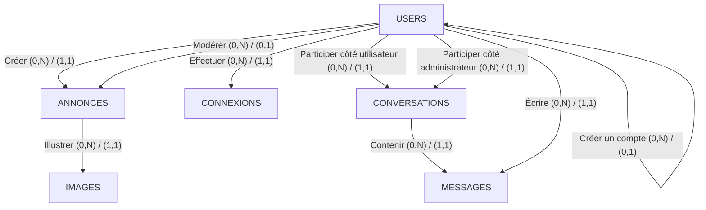
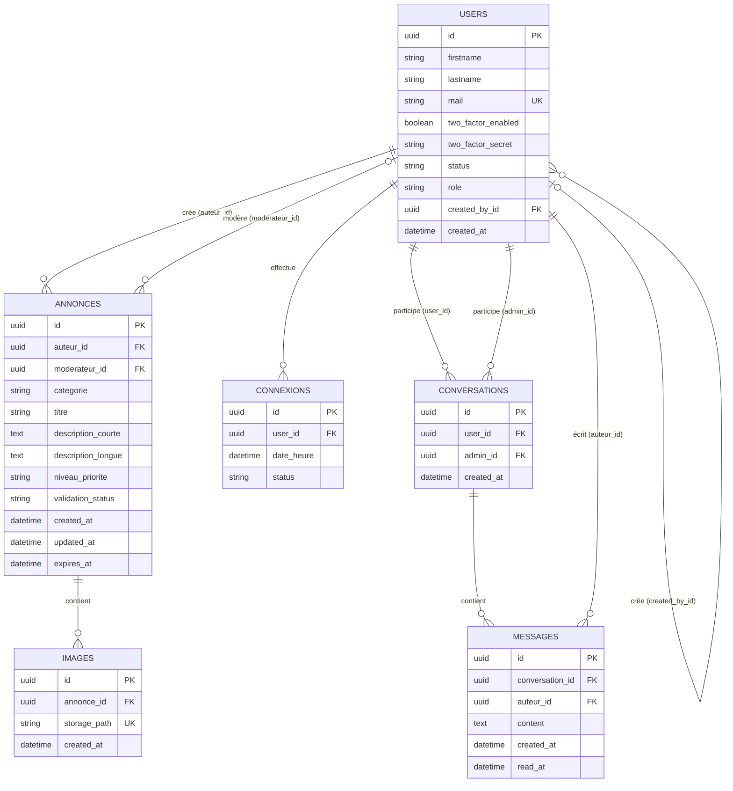

# Base de données – schéma v2

## 1. Cardinalités définitives

Les anciennes tables USERS, ADMINS et SUPERADMINS forment une seule table USERS portant un rôle (USER, ADMIN ou SUPERADMIN). Une table IMAGES s'ajoute pour les photos des annonces.

| Relation | Cardinalités | Explication |
| --- | --- | --- |
| USERS — Créer — ANNONCES | `USERS (0,N) — (1,1) ANNONCES` | Un utilisateur, quel que soit son rôle, peut créer plusieurs annonces. Chaque annonce possède un seul auteur. |
| USERS — Modérer — ANNONCES | `USERS (0,N) — (0,1) ANNONCES` | Un utilisateur ADMIN ou SUPERADMIN peut modérer plusieurs annonces. Une annonce est en attente (aucun modérateur) ou traitée par un seul modérateur, qui n'est jamais son auteur. |
| ANNONCES — Illustrer — IMAGES | `ANNONCES (0,N) — (1,1) IMAGES` | Une annonce peut avoir plusieurs images, ou aucune. Chaque image appartient à une seule annonce. |
| USERS — Effectuer — CONNEXIONS | `USERS (0,N) — (1,1) CONNEXIONS` | Un utilisateur peut avoir plusieurs connexions. |
| USERS — Participer (côté utilisateur) — CONVERSATIONS | `USERS (0,N) — (1,1) CONVERSATIONS` | Un utilisateur peut participer à plusieurs conversations. |
| USERS — Participer (côté administrateur) — CONVERSATIONS | `USERS (0,N) — (1,1) CONVERSATIONS` | Un utilisateur ADMIN ou SUPERADMIN peut participer à plusieurs conversations. |
| CONVERSATIONS — Contenir — MESSAGES | `CONVERSATIONS (0,N) — (1,1) MESSAGES` | Une conversation peut contenir plusieurs messages. Chaque message appartient à une seule conversation. |
| USERS — Écrire — MESSAGES | `USERS (0,N) — (1,1) MESSAGES` | Un utilisateur peut écrire plusieurs messages. Chaque message a exactement un auteur. |
| USERS — Créer un compte — USERS | `USERS (0,N) — (0,1) USERS` | Un ADMIN ou un SUPERADMIN peut créer plusieurs comptes. Un compte a au plus un créateur : aucun pour une inscription libre ni pour le premier superadmin. |

---

## 2. Diagramme EA avec Mermaid

Ce diagramme représente les entités et les relations métier. Un administrateur est un utilisateur : les entités ADMINS et SUPERADMINS n'existent plus et le rôle est désormais un attribut de USERS. Un administrateur peut créer des annonces, mais ne peut pas modérer les siennes.



### Fonctionnement de la modération

1. Un utilisateur, quel que soit son rôle, crée une annonce.
2. L'annonce est enregistrée avec le statut `EN_ATTENTE` et sans modérateur.
3. Un utilisateur ADMIN ou SUPERADMIN, autre que l'auteur, examine l'annonce.
4. Il la valide ou la refuse.
5. Le statut passe à `VALIDE` ou `DECLINE`, et `moderateur_id` contient le modérateur.

Un administrateur ne peut donc jamais valider sa propre annonce (conflit d'intérêts). La base de données garantit deux règles : `moderateur_id` est `NULL` si et seulement si le statut est `EN_ATTENTE`, et `moderateur_id` est toujours différent de `auteur_id`. Le rôle ADMIN ou SUPERADMIN du modérateur est, lui, vérifié par le back-end.

---

## 3. Diagramme relationnel avec Mermaid

Voici le modèle relationnel correspondant à ces règles : six tables au lieu de huit.



---

## Contraintes importantes pour PostgreSQL

**1. Une annonce et un message ont toujours un auteur.**

Les champs `annonces.auteur_id` et `messages.auteur_id` sont `NOT NULL` et référencent `users`. L'ancienne contrainte « exactement un auteur » n'existe plus : avec une seule colonne, l'état impossible n'est plus représentable.

**2. Un modérateur n'est jamais l'auteur, et le statut de l'annonce reste cohérent.**

Deux `CHECK` sur `annonces` : `moderateur_id` est différent de `auteur_id`, et `moderateur_id` est `NULL` si et seulement si `validation_status` vaut `EN_ATTENTE`.

**3. Un rôle parmi trois, un mail unique sans distinction de casse.**

`role` vaut `USER`, `ADMIN` ou `SUPERADMIN` (`CHECK`). L'unicité du mail porte sur `lower(mail)` : sans cela, `A@x.com` et `a@x.com` seraient deux comptes.

**4. Les images sont des références, les fichiers sont dans Supabase Storage.**

`images.storage_path` contient le chemin du fichier dans le bucket et est unique. Le stockage n'a pas de clés étrangères : c'est au back-end de supprimer les fichiers avant l'annonce, ce que force `ON DELETE RESTRICT`.

**5. Règles que la base ne peut pas vérifier et que le back-end doit garantir.**

Le modérateur d'une annonce et l'administrateur d'une conversation (colonne `admin_id`) doivent avoir le rôle ADMIN ou SUPERADMIN, car un `CHECK` ne peut pas comparer deux lignes différentes.

**6. Row Level Security activée sur toutes les tables.**

Supabase expose les tables du schéma `public` via sa propre API. Sans politique d'accès, cette API ne voit rien : seul le back-end accède aux données.

---

## Code PostgreSQL

À exécuter dans le SQL Editor de Supabase. L'ordre compte : une table doit exister avant d'être référencée par une clé étrangère.

```sql
-- 1. USERS
-- Every person of the app lives here. Admins and superadmins are users with a
-- higher role: one person = one row = one login. The role is a single column
-- (not two booleans) so that an impossible state such as "superadmin but not
-- admin" cannot be represented at all.
-- No pgcrypto extension needed: gen_random_uuid() is built into PostgreSQL 13+.

CREATE TABLE users (
    id                 UUID PRIMARY KEY DEFAULT gen_random_uuid(),

    firstname          VARCHAR(100) NOT NULL,
    lastname           VARCHAR(100) NOT NULL,
    mail               VARCHAR(255) NOT NULL,

    two_factor_enabled BOOLEAN      NOT NULL DEFAULT FALSE,
    two_factor_secret  TEXT,

    status             VARCHAR(20)  NOT NULL DEFAULT 'ACTIF',
    role               VARCHAR(20)  NOT NULL DEFAULT 'USER',

    -- Self-reference: who created this account. NULL for regular sign-ups
    -- and for the very first superadmin, who has no creator.
    created_by_id      UUID,

    created_at         TIMESTAMPTZ  NOT NULL DEFAULT CURRENT_TIMESTAMP,

    CONSTRAINT fk_users_created_by
        FOREIGN KEY (created_by_id)
        REFERENCES users(id)
        ON DELETE RESTRICT,

    CONSTRAINT chk_users_status
        CHECK (status IN ('ACTIF', 'BLOQUE')),

    CONSTRAINT chk_users_role
        CHECK (role IN ('USER', 'ADMIN', 'SUPERADMIN')),

    CONSTRAINT chk_users_not_self_created
        CHECK (created_by_id IS NULL OR created_by_id <> id)
);

-- A plain UNIQUE on "mail" is case-sensitive: "A@x.com" and "a@x.com" would be
-- two accounts. Indexing lower(mail) makes the uniqueness case-insensitive.
CREATE UNIQUE INDEX uq_users_mail_lower
    ON users (lower(mail));

-- 2. ANNONCES

CREATE TABLE annonces (
    id                 UUID PRIMARY KEY DEFAULT gen_random_uuid(),

    auteur_id          UUID         NOT NULL,
    -- NULL as long as nobody has processed the announcement.
    moderateur_id      UUID,

    categorie          VARCHAR(50)  NOT NULL,
    titre              VARCHAR(255) NOT NULL,
    description_courte TEXT,
    description_longue TEXT         NOT NULL,

    niveau_priorite    VARCHAR(20)  NOT NULL DEFAULT 'STANDARD',
    validation_status  VARCHAR(20)  NOT NULL DEFAULT 'EN_ATTENTE',

    created_at         TIMESTAMPTZ  NOT NULL DEFAULT CURRENT_TIMESTAMP,
    updated_at         TIMESTAMPTZ  NOT NULL DEFAULT CURRENT_TIMESTAMP,
    expires_at         TIMESTAMPTZ,

    CONSTRAINT fk_annonces_auteur
        FOREIGN KEY (auteur_id)
        REFERENCES users(id)
        ON DELETE RESTRICT,

    CONSTRAINT fk_annonces_moderateur
        FOREIGN KEY (moderateur_id)
        REFERENCES users(id)
        ON DELETE RESTRICT,

    CONSTRAINT chk_annonces_categorie
        CHECK (categorie IN (
            'OBJET_TROUVE',
            'OBJET_A_DONNER',
            'EVENEMENT',
            'APPEL_A_PROJET',
            'PUBLICITE',
            'ANNONCE_ADMINISTRATION'
        )),

    CONSTRAINT chk_annonces_priorite
        CHECK (niveau_priorite IN ('STANDARD', 'HAUTE_PRIORITE', 'A_LA_UNE')),

    CONSTRAINT chk_annonces_validation
        CHECK (validation_status IN ('EN_ATTENTE', 'VALIDE', 'DECLINE')),

    -- Conflict of interest: nobody moderates their own announcement.
    -- Last line of defence in case the application code has a bug.
    CONSTRAINT chk_annonces_no_self_moderation
        CHECK (moderateur_id IS NULL OR moderateur_id <> auteur_id),

    -- The status and the moderator must tell the same story:
    -- pending <=> no moderator yet; validated or declined <=> a moderator acted.
    CONSTRAINT chk_annonces_moderation_coherence
        CHECK (
            (validation_status = 'EN_ATTENTE' AND moderateur_id IS NULL)
            OR
            (validation_status <> 'EN_ATTENTE' AND moderateur_id IS NOT NULL)
        ),

    CONSTRAINT chk_annonces_dates
        CHECK (expires_at IS NULL OR expires_at > created_at)
);

-- 3. IMAGES
-- Metadata only: the file itself lives in a Supabase Storage bucket (same
-- project, no second database). storage_path is the only link between the
-- two. Storage has no foreign keys, so consistency between a row and its file
-- is the back-end's responsibility.
-- ON DELETE RESTRICT on purpose: with CASCADE, deleting an announcement would
-- erase the paths and leave orphan files in the bucket. RESTRICT forces the
-- back-end to delete the files first.

CREATE TABLE images (
    id            UUID PRIMARY KEY DEFAULT gen_random_uuid(),

    annonce_id    UUID         NOT NULL,
    storage_path  VARCHAR(500) NOT NULL,

    created_at    TIMESTAMPTZ  NOT NULL DEFAULT CURRENT_TIMESTAMP,

    CONSTRAINT fk_images_annonces
        FOREIGN KEY (annonce_id)
        REFERENCES annonces(id)
        ON DELETE RESTRICT,

    -- Two rows must never point to the same file.
    CONSTRAINT uq_images_storage_path
        UNIQUE (storage_path)
);

-- 4. CONNEXIONS

CREATE TABLE connexions (
    id         UUID PRIMARY KEY DEFAULT gen_random_uuid(),

    user_id    UUID        NOT NULL,
    date_heure TIMESTAMPTZ NOT NULL DEFAULT CURRENT_TIMESTAMP,
    status     VARCHAR(20) NOT NULL,

    CONSTRAINT fk_connexions_users
        FOREIGN KEY (user_id)
        REFERENCES users(id)
        ON DELETE RESTRICT,

    CONSTRAINT chk_connexions_status
        CHECK (status IN ('REUSSIE', 'ECHOUEE', 'DECONNECTE'))
);

-- 5. CONVERSATIONS
-- A conversation links a user and an admin. Both columns reference users:
-- that the second one really has the ADMIN role cannot be expressed with a
-- CHECK (it compares two different rows), so the back-end enforces it.

CREATE TABLE conversations (
    id         UUID PRIMARY KEY DEFAULT gen_random_uuid(),

    user_id    UUID        NOT NULL,
    admin_id   UUID        NOT NULL,

    created_at TIMESTAMPTZ NOT NULL DEFAULT CURRENT_TIMESTAMP,

    CONSTRAINT fk_conversations_user
        FOREIGN KEY (user_id)
        REFERENCES users(id)
        ON DELETE RESTRICT,

    CONSTRAINT fk_conversations_admin
        FOREIGN KEY (admin_id)
        REFERENCES users(id)
        ON DELETE RESTRICT,

    CONSTRAINT chk_conversations_distinct_participants
        CHECK (user_id <> admin_id)
);

-- 6. MESSAGES
-- Since admins are users, a single author column is enough: the old
-- "exactly one author" constraint is no longer needed because the impossible
-- state does not exist anymore.

CREATE TABLE messages (
    id              UUID PRIMARY KEY DEFAULT gen_random_uuid(),

    conversation_id UUID        NOT NULL,
    auteur_id       UUID        NOT NULL,

    content         TEXT        NOT NULL,

    created_at      TIMESTAMPTZ NOT NULL DEFAULT CURRENT_TIMESTAMP,
    read_at         TIMESTAMPTZ,

    CONSTRAINT fk_messages_conversations
        FOREIGN KEY (conversation_id)
        REFERENCES conversations(id)
        ON DELETE RESTRICT,

    CONSTRAINT fk_messages_auteur
        FOREIGN KEY (auteur_id)
        REFERENCES users(id)
        ON DELETE RESTRICT,

    CONSTRAINT chk_messages_dates
        CHECK (read_at IS NULL OR read_at >= created_at)
);

-- 7. INDEXES
-- PostgreSQL indexes primary keys and UNIQUE constraints automatically, but
-- NOT foreign keys. Without these, every join or lookup on a foreign key
-- scans the whole table.

CREATE INDEX idx_users_created_by
    ON users (created_by_id);

CREATE INDEX idx_annonces_auteur
    ON annonces (auteur_id);

CREATE INDEX idx_annonces_moderateur
    ON annonces (moderateur_id);

CREATE INDEX idx_annonces_statut
    ON annonces (validation_status);

CREATE INDEX idx_annonces_date_creation
    ON annonces (created_at DESC);

CREATE INDEX idx_images_annonce
    ON images (annonce_id);

CREATE INDEX idx_connexions_user_date
    ON connexions (user_id, date_heure DESC);

CREATE INDEX idx_conversations_user
    ON conversations (user_id);

CREATE INDEX idx_conversations_admin
    ON conversations (admin_id);

CREATE INDEX idx_messages_conversation_date
    ON messages (conversation_id, created_at);

CREATE INDEX idx_messages_auteur
    ON messages (auteur_id);

-- 8. ROW LEVEL SECURITY
-- Supabase automatically exposes tables of the "public" schema through its own
-- REST API. Our API is Spring Boot, so nobody should reach the tables that
-- way. With RLS enabled and no policy, that public API sees nothing.
-- Spring connects with the database owner role, which bypasses RLS
-- (to be verified when we connect Spring Boot).

ALTER TABLE users         ENABLE ROW LEVEL SECURITY;
ALTER TABLE annonces      ENABLE ROW LEVEL SECURITY;
ALTER TABLE images        ENABLE ROW LEVEL SECURITY;
ALTER TABLE connexions    ENABLE ROW LEVEL SECURITY;
ALTER TABLE conversations ENABLE ROW LEVEL SECURITY;
ALTER TABLE messages      ENABLE ROW LEVEL SECURITY;
```

## Roles Supabase : 


| Rôle          | Signification                     | Usage typique                                         |
| ------------- | --------------------------------- | ----------------------------------------------------- |
| anon          | Requête sans utilisateur connecté | Données publiques, catalogue, articles                |
| authenticated | Utilisateur connecté avec un JWT  | Données personnelles, CRUD sur ses propres ressources |
| service_role  | Backend / serveur privilégié      | Tâches administratives ; contourne RLS                |

Dans `Supabase` Il existe un dispositif de securite nommee `RLS "Row Level Security "`. En activant le RLS sur une table sans definir aucune policy, les role comme `anon` et `authenticated` ne peuvent donc pas avoir acces a l'API de supabase , le seul moyen d'avoir les donnees est de passer par le serveur du backed dans notre cas c'est ` Springboot`.  On appelle cela le `Deny by default`. 